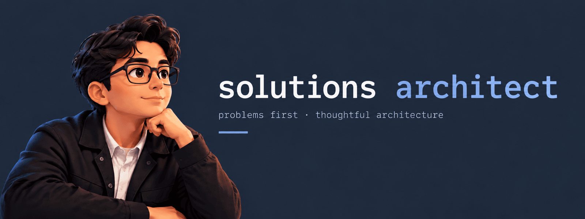

<h1 align="center">Miguel Ángel Barreto</h1>

  <strong>Architecture ideas, explored in code and shared in the open.</strong> 
  A software engineer's mindset applied to system design.

  <a href="#about-me">About</a> &nbsp;·&nbsp;
  <a href="#featured-projects">Projects</a> &nbsp;·&nbsp;
  <a href="#latest-writing">Writing</a> &nbsp;·&nbsp;
  <a href="#connect">Connect</a>

## About Me

### 🧭 Start with the problem. Make the tradeoffs explicit.

I translate business needs into clear technical solutions. Before choosing a framework or drawing a system boundary, I want to understand **what needs to work, why it matters, and what we are willing to trade off**.

My software engineering background keeps architecture close to implementation. I'm interested in clean architecture, distributed systems, and cloud-native applications. More than that, I care about making those ideas useful without adding complexity.

**What I care about:** maintainability · clear decisions · code quality · shared learning.

## Featured Projects

A closer look at the ideas I explore through code.

### 01 &nbsp; 🧱 .NET Clean Architecture

**Business rules with clear, testable boundaries.**

An API-first reference for catalog, inventory, and orders. Follow a business operation from HTTP through application handlers and domain rules to PostgreSQL.

[Explore the architecture →](https://github.com/mbarretot/dotnet-clean-architecture)

### 02 &nbsp; 🔐 GitHub Actions → Azure OIDC

**Deploy with federated identity, not a stored client secret.**

A reference lab for deploying an ASP.NET Core API to Azure App Service using GitHub Actions, OpenID Connect, and Microsoft Entra ID.

[Explore the deployment lab →](https://github.com/mbarretot/github-actions-azure-oidc)

### 03 &nbsp; 🛒 eShop Modular Monolith

**Module boundaries before microservices.**

An e-commerce backend in .NET with Catalog, Basket, and Ordering modules behind a single API host. One deployable with clear seams, ready to split only when the business needs it.

[Explore the repository →](https://github.com/mbarretot/eshop-modular-monolith)

## Latest Writing

Notes on architecture and cloud identity from [Plano](https://www.planoarch.com) (in Spanish).

- **[Workload Identity Federation](https://www.planoarch.com/blog/workload-identity-federation)**: deploying from GitHub Actions to Azure without secrets.
- **[Managed Identity](https://www.planoarch.com/blog/managed-identity)**: applications that authenticate without storing passwords.
- **[Entra ID B2B](https://www.planoarch.com/blog/entra-id-b2b)**: collaborating with external users without managing their credentials.

## Connect

**Have a problem worth thinking through? Let's connect.**

  
  

  
  
  

